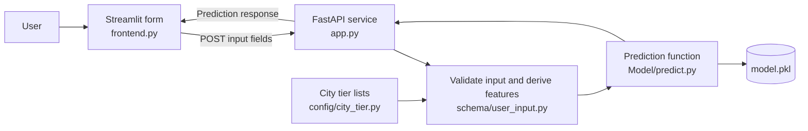

# Insurance Premium Category Predictor

This project estimates an insurance premium category (`Low`, `Medium`, or `High`) from a person's age, height, weight, income, smoking status, city, and occupation. It includes a Streamlit form for entering these details and a FastAPI service that validates the input, derives model features, and runs a pre-trained scikit-learn model.

The repository includes a saved model and a CSV dataset, but no model-training script or training instructions. The application uses the saved model at runtime.

## Features

- Interactive web form with a live BMI calculation and prediction display.
- FastAPI endpoints for health checks and category predictions.
- Input validation and feature derivation in the API.
- Prediction confidence and per-class probabilities returned by the model.

## How it fits together



The form sends raw user details to the API. The API computes BMI, age group, lifestyle risk, and city tier before passing those features to the model.

## Project structure

| Path | Purpose |
| --- | --- |
| `app.py` | FastAPI application and HTTP routes. |
| `frontend.py` | Streamlit user interface; its API URL is set in this file. |
| `schema/user_input.py` | Validates request fields and derives model features. |
| `schema/prediction_response.py` | Declares the documented prediction response fields. |
| `config/city_tier.py` | Lists the configured tier 1 and tier 2 cities. Other cities are treated as tier 3. |
| `Model/predict.py` | Loads the saved model and calculates the prediction, confidence, and class probabilities. |
| `Model/model.pkl` | Pre-trained scikit-learn pipeline loaded by the API. |
| `insurance.csv` | Dataset with personal/lifestyle input columns and the `insurance_premium_category` target column. |
| `requirements.txt` | Pinned Python package requirements. |

## Requirements and installation

Use Python and pip. The repository does not declare a supported Python version; the current project environment uses Python 3.12. The model was verified to load with the pinned scikit-learn version in `requirements.txt`.

From the project directory, create and activate a virtual environment:

```powershell
python -m venv .venv
.\.venv\Scripts\Activate.ps1
```

In Command Prompt, activate it with:

```bat
.venv\Scripts\activate.bat
```

On macOS or Linux, activate it with:

```sh
source .venv/bin/activate
```

Install the pinned dependencies and Streamlit:

```sh
python -m pip install -r requirements.txt
python -m pip install streamlit
```

## Run the application

Start the API from the project directory:

```sh
python -m uvicorn app:app --reload
```

The API listens at `http://127.0.0.1:8000` by default. In a second terminal, with the same virtual environment active, start the UI:

```sh
streamlit run frontend.py
```

Open the local URL printed by Streamlit in your browser. The frontend currently sends requests to `http://127.0.0.1:8000/predict`; to use a different API address, update `API_URL` in `frontend.py`. No environment variables are read by the application.

FastAPI's interactive API documentation is available at `http://127.0.0.1:8000/docs` while the API is running.

## API

### `GET /`

Returns a short service message:

```json
{"message": "Insurance Premium Prediction API"}
```

### `GET /health`

Returns the service status, model version, and whether the model loaded:

```json
{"status": "OK", "version": "1.0.0", "model_loaded": true}
```

### `POST /predict`

Send a JSON body with these fields:

| Field | Type | Validation / accepted values |
| --- | --- | --- |
| `age` | integer | Greater than 0 and less than 120. |
| `weight` | number | Greater than 0; kilograms in the UI. |
| `height` | number | Greater than 0 and less than 2.5; metres in the UI. |
| `income_lpa` | number | Greater than 0; annual income in lakh per annum. |
| `smoker` | boolean | `true` or `false`. |
| `city` | string | Trimmed and converted to title case before city-tier lookup. |
| `occupation` | string | `retired`, `freelancer`, `student`, `government_job`, `business_owner`, `unemployed`, or `private_job`. |

Example request:

```sh
curl -X POST http://127.0.0.1:8000/predict \
  -H "Content-Type: application/json" \
  -d '{
    "age": 30,
    "weight": 65,
    "height": 1.7,
    "income_lpa": 10,
    "smoker": false,
    "city": "Mumbai",
    "occupation": "private_job"
  }'
```

The API derives model inputs as follows:

- BMI is `weight / height²`.
- Age groups are `young` (under 25), `adult` (25–44), `middle_aged` (45–59), and `senior` (60 and older).
- Lifestyle risk is `high` when the person smokes and has BMI above 30; otherwise it is `medium` when they smoke or have BMI above 27, and `low` in other cases.
- Cities in `config/city_tier.py` are assigned tier 1 or 2; all other city names are assigned tier 3.

#### Current prediction response shape

The endpoint currently returns a nested object. For the example request, the response has this shape (prediction values are model output):

```json
{
  "predicted_category": {
    "predictes_category": "Low",
    "confidence": 0.69,
    "class_probabilities": {
      "High": 0.01,
      "Low": 0.69,
      "Medium": 0.3
    }
  }
}
```

There is a mismatch in the current code: `schema/prediction_response.py` declares a flat `predicted_category`, `confidence`, and `class_probabilities` response, while `app.py` wraps the prediction dictionary under `predicted_category`. The inner category key is also spelled `predictes_category` in `Model/predict.py`. The Streamlit UI handles the nested response, but API clients should account for this actual shape.

## Notes

- Predictions are estimates, not official insurance quotes.


